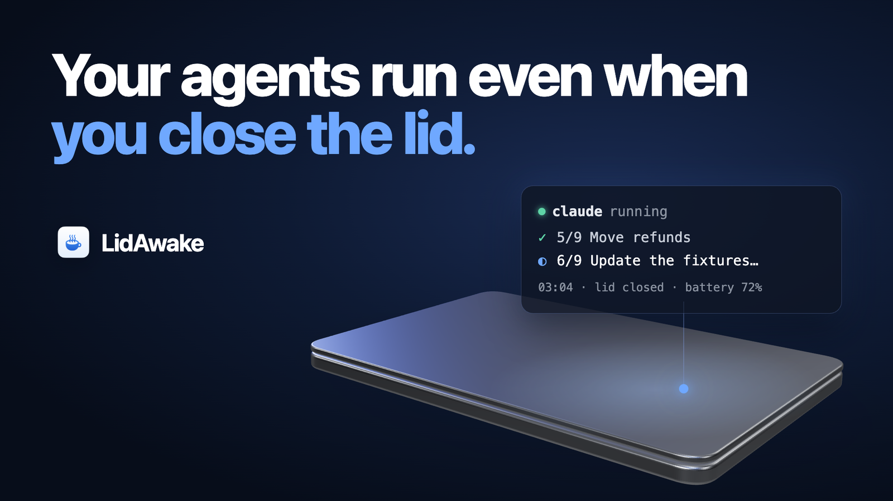
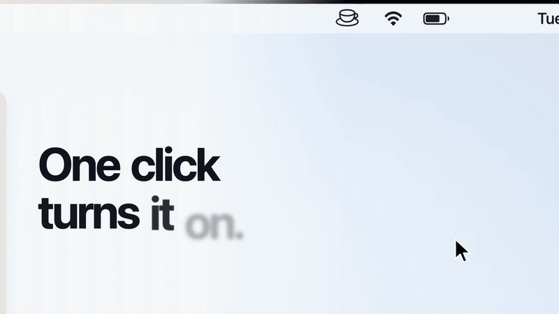
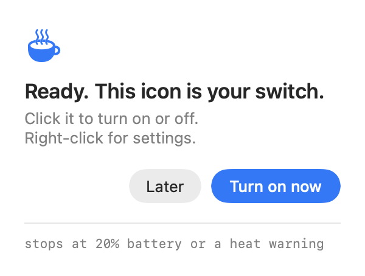

<p align="center">
  
</p>

# LidAwake

A free, open source menu bar app for macOS. Click the cup, close the lid, and your MacBook keeps running, so Claude Code, Codex, Droid and other CLI agents keep working through the night.

It turns itself off and sleeps the Mac at a battery level you pick, or when macOS reports a heat warning. When you open the lid, it tells you whether the Mac really stayed awake.

<p align="center">
  
</p>

Version 0.4.0 · macOS 14 or later · Apple silicon and Intel · no network code · MIT licence

## Install

Paste this into Claude Code, Codex or Droid:

```text
Install LidAwake for me.
Clone https://github.com/krishna-goutham-tls/lidawake.git into ~/lidawake
and run ~/lidawake/scripts/install.sh.
Then tell me to click the cup in the menu bar and choose "Allow once".
```

Or run it in Terminal yourself:

```sh
git clone https://github.com/krishna-goutham-tls/lidawake.git ~/lidawake
~/lidawake/scripts/install.sh
```

The script builds the app on your Mac with Apple's Command Line Tools (`xcode-select --install` if you do not have them) and copies it to `/Applications`. It needs no sudo. An app you build yourself opens without a Gatekeeper warning.

There is also a zip on the [Releases](https://github.com/krishna-goutham-tls/lidawake/releases) page. It is not notarized yet, so macOS blocks the first open. Open it once, then go to System Settings → Privacy & Security and click **Open Anyway**.

## Use

1. The first time, a panel drops down from the cup. Click **Allow once** and enter your Mac password. You do this once.

   <picture>
     <source media="(prefers-color-scheme: dark)" srcset="docs/panel-ready-dark.png">
     
   </picture>

2. Click the cup. It starts steaming. Close the lid.

   <picture>
     <source media="(prefers-color-scheme: dark)" srcset="docs/panel-on-dark.png">
     
   </picture>

3. Click the cup again to turn it off. Off means normal sleep.

Right-click the cup for settings: time on and battery, the battery cutoff, the log, removing the permission, and Quit.

## When it stops

- On battery, at the cutoff. The default is 20%. Change it under **Stop at battery**.
- When macOS reports a serious or critical heat state.
- When you click the cup, quit the app, or the app is killed.

Each time, it turns closed-lid mode off and lets the Mac sleep. If the app crashes, a watchdog restores normal sleep within about a minute, and sleeps the Mac if the lid is shut. The app also keeps checking that the setting matches the cup, and puts it back if something reset it.

Keep the Mac on a hard, ventilated surface. Do not run it inside a bag.

## What it changes on your Mac

Read this before you click **Allow once**. The scripts are in [`Resources/`](Resources).

| What | Where | Why |
|---|---|---|
| A sudoers rule for your user, two commands only | `/etc/sudoers.d/lidawake` | So the cup can run `pmset` without a password each time |
| A watchdog | `~/Library/LaunchAgents/space.thelaunch.lidawake.watchdog.plist` | Restores normal sleep if the app dies |
| A log | `~/Library/Logs/LidAwake.log` | The place to look when something goes wrong |

The whole sudoers rule is one line:

```
you ALL=(root) NOPASSWD: /usr/bin/pmset -a disablesleep 0, /usr/bin/pmset -a disablesleep 1
```

There is no network code and no analytics. Nothing leaves your Mac. macOS shows a one-time "Background Items Added" alert for the watchdog, and lists it under System Settings → General → Login Items.

## Why not caffeinate

`caffeinate`, keep-awake timers and power assertions stop idle sleep only. Closing the lid still sleeps a MacBook unless an external display is attached. `pmset -a disablesleep 1` is the setting that stops lid sleep. It also stays on across restarts, so LidAwake turns it off again on every way out: switch off, quit, crash, battery, heat and the watchdog.

## What it cannot fix

- Keeping the Mac awake does not keep it online. If you leave your Wi-Fi, cloud-backed agents stop.
- An agent that waits for a permission prompt or hits a usage limit stays stuck, lid open or closed.
- If the Mac restarts while the switch is on, it stays awake at the login screen until you log in. The watchdog restores normal sleep right after login.

## Uninstall

Right-click the cup, click **Remove closed-lid permission**, quit the app, and delete it from `/Applications`. If the app is gone already:

```sh
sudo rm -f /etc/sudoers.d/lidawake && sudo pmset -a disablesleep 0
launchctl bootout gui/$(id -u)/space.thelaunch.lidawake.watchdog
rm -f ~/Library/LaunchAgents/space.thelaunch.lidawake.watchdog.plist
rm -rf ~/Library/Application\ Support/LidAwake
```

<details>
<summary><b>Build from source and test it</b></summary>

```sh
./build.sh                  # makes build/LidAwake.app, ad-hoc signed
sh scripts/selftest.sh      # checks the scripts, no root, no system changes
build/LidAwake.app/Contents/MacOS/LidAwake --selftest

# Render a panel screen to PNG without touching sleep settings
build/LidAwake.app/Contents/MacOS/LidAwake --preview-panel setUp /tmp/setup.png [--dark]
#   screens: setUp, turnOn, waiting, failed, ready, info, on, off

# Regenerate the app icon after changing Sources/AppIcon.swift
build/LidAwake.app/Contents/MacOS/LidAwake --render-iconset /tmp/AppIcon.iconset
iconutil -c icns /tmp/AppIcon.iconset -o Resources/AppIcon.icns
```

Plain `swiftc`, AppKit, no Xcode project and no dependencies.

| # | Do this | Pass when |
|---|---|---|
| 1 | Set up closed-lid mode | One password prompt. The menu shows **Remove closed-lid permission** |
| 2 | Start a long agent task. Switch on. Unplug. Close the lid for 30 min on a desk | The log has `lid=closed` heartbeats about every minute, and the agent kept working |
| 3 | Switch off. Close the lid for 2 min | No heartbeats. `pmset -g \| grep SleepDisabled` prints nothing or `0` |
| 4 | On battery, set **Stop at battery** above the current level, switch on | Within 30 s the switch turns off and the Mac sleeps. The log says why |
| 5 | `defaults write space.thelaunch.lidawake debugForceThermal -string serious`, then switch on | The switch refuses to start, saying macOS reports serious heat. Switch on first, then run the command, and within 30 s it stops and sleeps. Clear it with `defaults delete space.thelaunch.lidawake debugForceThermal` |
| 6 | Switch on, then `pkill -9 -x LidAwake` | Within about 60 s the log shows `[watchdog] app not running, restored normal sleep` |
| 6b | Switch on, run `sleep 20; pkill -9 -x LidAwake` in Terminal, close the lid within 20 s, wait 3 min, open it | The log shows `[watchdog] lid is closed, put the Mac to sleep`, and `pmset -g log \| grep -i sleep` shows a sleep a minute or so after the kill |
| 7 | Switch on, then restart the Mac | After login, `pmset -g \| grep SleepDisabled` prints nothing or `0` |
| 8 | Switch on, then **Quit LidAwake** | `SleepDisabled` is back to `0` |
| 9 | **Remove closed-lid permission** | `/etc/sudoers.d/lidawake` and the LaunchAgent are gone |
| 10 | Leave it off for 10 min, then on for 10 min with the panel closed | Activity Monitor shows 0% CPU both times |
| 11 | Switch on, close the lid for 10 min, open it and unlock | A panel says "Your Mac stayed awake 10 min with the lid closed." The menu shows a `last lid close` line |
| 12 | Switch on, then in Terminal run `sudo pmset -a disablesleep 0` | Within 30 s the log says closed-lid mode was turned on again, and `SleepDisabled` is `1` |

The launch video is code too: Remotion with a MacBook modelled in three.js. See [`launch-video/`](launch-video).

</details>

## Licence

MIT. See [LICENSE](LICENSE).
